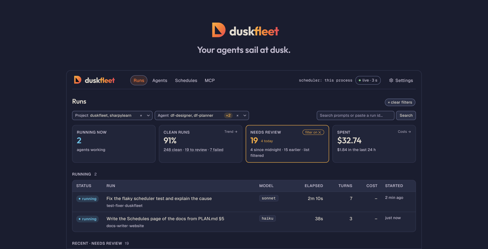
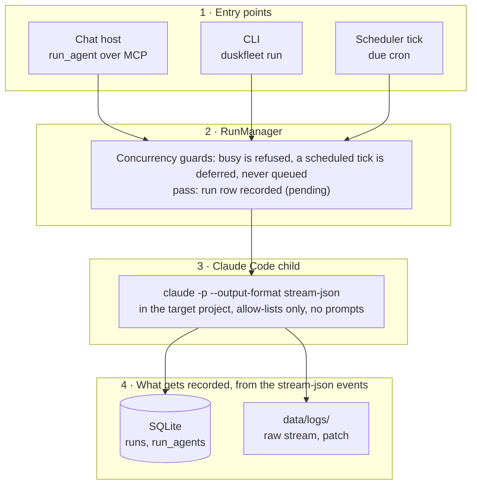
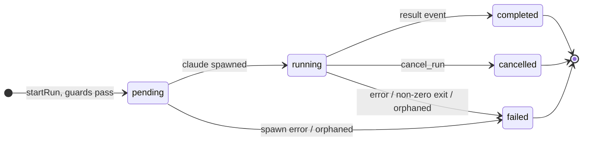

<div align="center">

<picture>
  <source media="(prefers-color-scheme: dark)" srcset="docs/assets/logo-dark.svg">
  <source media="(prefers-color-scheme: light)" srcset="docs/assets/logo-light.svg">
  
</picture>

# Duskfleet

### Run, record and schedule unattended Claude Code agents on your local projects.

*Your agents sail at dusk.*

**A fleet of agents for your own machine.**

Website: [duskfleet.com](https://duskfleet.com/?utm_source=github&utm_medium=readme&utm_campaign=always-on&utm_content=hero)

[](https://github.com/duskfleet/duskfleet/actions/workflows/ci.yml)
[](https://nodejs.org/)
[](LICENSE)
[](docs/mcp-server.md)

[Quick start](#quick-start) ·
[First scheduled run](docs/quickstart.md) ·
[From source](#from-source) ·
[Before / after](#before--after) ·
[How it works](#how-it-works) ·
[What you get](#what-you-get) ·
[Commands](#commands) ·
[FAQ](#faq) ·
[Status and roadmap](#status-and-roadmap) ·
[Documentation](#documentation) ·
[Contributing](#contributing) ·
[License](#license) ·
[Star history](#star-history) ·
[Website](https://duskfleet.com/?utm_source=github&utm_medium=readme&utm_campaign=always-on&utm_content=readme)

</div>

**Who it is for:** people who already run Claude Code on their own projects and want those runs
unattended, scheduled and recorded, on their own machine. Duskfleet runs `claude -p` against a
project on your disk and keeps a record of what happened.

- **Local, no account, no cloud**: everything runs on your machine with your own Claude Code
  login; there is no service in between.
- **Every run recorded**: events, tool calls, permission denials, tokens and cost land in a
  local SQLite database, plus a JSONL log per run.
- **Cron schedules and a dashboard**: schedules fire from a local process, and a dashboard on
  localhost shows runs, schedules and agents. It never writes runs; it edits agent files,
  schedules and the editable settings keys.

<div align="center">



</div>

## Quick start

Requirements: a supported platform (below), Node.js **24+** (built-in `node:sqlite`, no native
addons; `.nvmrc` pins it, and an older Node gets `Duskfleet needs Node 24 or newer; you have
vX.Y.Z`), and [Claude Code](https://docs.anthropic.com/en/docs/claude-code) installed and
**logged in** for the user that runs Duskfleet (Duskfleet does not manage authentication).
Only runs need the login: before it, `init`, `doctor`, `agents create`, the other read-only
commands and the dashboard already work, and `init` ends with the command to log in.

### Platform support

| Platform | Status | Notes |
|---|---|---|
| macOS | Supported | Developed and run daily by the maintainers; `install-service` uses launchd |
| Linux | Supported | `install-service` uses a systemd user unit |
| Windows | **Experimental** | Implemented (`install-service` registers a Task Scheduler logon task) but not run by the maintainers. The service log is `data/logs/serve.log`, the task XML is kept under `%LOCALAPPDATA%\Duskfleet`. Help verify it with the [Windows test plan](docs/windows-test-plan.md) |

This table is the one place that states platform support; other pages link here.

Nothing to clone: the CLI comes from npm.

```bash
npx duskfleet init             # checks Node and the Claude Code login, creates the config and data directories
npx duskfleet doctor           # Claude binary, version, where config and data live
```

Install only from the [`duskfleet/duskfleet`](https://github.com/duskfleet/duskfleet) repository
on GitHub or the [`duskfleet`](https://www.npmjs.com/package/duskfleet) package on npm. No other
source is official.

`init` creates the user-level config and data directories (`~/.config/duskfleet` and
`~/.local/share/duskfleet` on Linux and macOS, [Configuration](docs/configuration.md)) and, on a
terminal, offers to register the MCP server in Claude Code or Claude Desktop; `--yes` skips the
questions. See [`init`](docs/cli.md#init).

Duskfleet ships no starter agent: create your first one, on the cheapest model. `agents create`
writes it to the data directory's `agents/fixer.md` with safe defaults: a $0.50 budget, no
permission prompts (`dontAsk`), file tools plus the common test commands, 10 minutes.

```bash
npx duskfleet agents create fixer --model haiku -- "You fix the failing test in this project. Run the tests, read the failure, change the minimum code, run them again. No git, no installs."
```

Then try it on a small throwaway project of your own (anything with a failing test will do):

```bash
npx duskfleet run --project /abs/path/to/scratch-project --agent fixer -- "Fix the failing test"
npx duskfleet runs
npx duskfleet dashboard        # installs the dashboard on first use, opens http://localhost:4777
```

`run` and `runs` print a human view; scripts add `--json` ([CLI output](docs/cli.md#output)).

Before running agents unattended, review the [security boundaries](docs/security.md) and set
[`allowed_project_roots`](docs/configuration.md#configduskfleetyaml) to the project directories you intend to expose.

> [!WARNING]
> Real runs cost money. An agent without an explicit `model` uses the Claude Code default; set
> `haiku` or `sonnet` while experimenting.

Then register the MCP server in Claude Code or Claude Desktop, if `init` did not:
`npx duskfleet mcp register --target claude-code --dry-run` shows the change, the same command
without `--dry-run` makes it (`--target claude-desktop` for the desktop app). Ask the assistant
to create agents, start runs and set up schedules: see [MCP server](docs/mcp-server.md).

To keep schedules firing with Claude Desktop closed, register the scheduler as a per-user
service once. The service needs a global install, not npx's temporary cache:
`npm i -g duskfleet`, then `duskfleet install-service`
([Schedules](docs/schedules.md#who-ticks)).

From here to a schedule that fires on its own, step by step in about ten minutes:
[Your first scheduled run](docs/quickstart.md).

## From source

For contributors, or to run an unreleased `main`:

```bash
git clone https://github.com/duskfleet/duskfleet.git
cd duskfleet
npm install
npm run build
npm run cli -- init --yes
```

In a clone every `npx duskfleet <command>` above is `npm run cli -- <command>`, and the dashboard
is `npm run web`; `init` finds the repo's `config/` and leaves it as it is, and the data lands in
the clone's `data/` (git-ignored). Setup, rules and checks: [CONTRIBUTING.md](CONTRIBUTING.md).

## Before / after

**Before**: `claude -p` started by hand or from a crontab, the output in a terminal, and no
record of what happened overnight.

**After**: agents are Markdown files ([Agents](docs/agents.md)); cron schedules keep a busy tick as
one pending fire, retried until the agent is free or the next occurrence comes, and never catch
up after sleep ([Schedules](docs/schedules.md#busy-ticks-one-deferred-fire));
every event, tool call, permission denial, token and dollar lands in SQLite plus a JSONL log per
run ([What a run records](docs/cli.md#what-a-run-records)); and in the dashboard a run that hit a
permission denial is "needs review", never green ([Needs review](docs/dashboard.md#needs-review)).

## How it works

Every run starts as a call to `RunManager.startRun`, from a chat, the CLI or a cron schedule.
The child is Claude Code in your project; everything it does is recorded.



Whatever the entry point, the request lands in `RunManager`, the only thing that creates runs and
changes their status. Its concurrency guards run first (one run per project directory and one per
agent by default): a busy guard refuses, nothing is ever queued, and a schedule keeps that tick as its
one pending fire until the next cron occurrence. When the guards pass the run row is recorded and the
executor spawns Claude Code in the target project with the agent's allow-lists, model and budget, no
permission prompts and no MCP servers unless the agent opts in. Every JSON event the child prints is
parsed as it arrives: the row in SQLite holds status, timings, tokens, cost, tool calls, permission
denials and the termination reason, one `run_agents` row per subagent, while the raw stream and the
patch of what changed land in `data/logs/`. The dashboard only reads that database.

A run moves through these states; the transitions below are the only ones allowed:



"Needs review" is not a status but how the dashboard shows a completed run that hit a permission
denial, a timeout, an exhausted budget or did nothing: amber, never plain green.

You describe *what should happen* in `config/` (agents, projects) and in schedules. Duskfleet
runs `claude -p` unattended with a target project as working directory, owns the unattended
envelope (permissions, allow-lists, budget, MCP) and records *what happened*. A run end to end,
with diagrams: [How it works](docs/how-it-works.md).

## What you get

| | |
|---|---|
| **Agents** | Markdown files: a persona of your own, or a link to an agent the project already defines in `.claude/agents/`. [Agents](docs/agents.md) |
| **Runs** | Every event, tool call, permission denial, token and dollar, in SQLite and a JSONL log per run. [CLI](docs/cli.md) |
| **Schedules** | Cron schedules that defer a busy tick as one pending fire, retried until the agent is free or the next occurrence; no queue, no catch-up after sleep. [Schedules](docs/schedules.md) |
| **Dashboard** | Runs with cost, timeline and issues; a run that hit a permission denial is "needs review", never green. [Dashboard](docs/dashboard.md) |
| **MCP tools** | 19 tools to create agents, start and inspect runs and manage schedules from a chat. [MCP server](docs/mcp-server.md) |
| **CLI** | The same operations from a terminal, plus `serve` and `install-service` for the scheduler. [CLI](docs/cli.md) |

## Commands

Each command is `npx duskfleet <command>` (`duskfleet <command>` after `npm i -g duskfleet`, or
`npm run cli -- <command>` in a clone), and every CLI command answers `--help`; the last two
rows are npm scripts of a clone. The full reference, with every
option: [CLI](docs/cli.md).

| Command | What it does |
|---|---|
| `doctor` | Claude binary and version, where config and data live, scheduler state. [CLI](docs/cli.md#doctor-logs-and-diffs) |
| `run --project <id or path> --agent <id> [--model <m>] [--no-wait] -- "<task>"` | Starts one run and prints its record. [CLI](docs/cli.md) |
| `runs` | Lists recorded runs, with `needsReview` and the reasons. [CLI](docs/cli.md#what-a-run-records) |
| `run-info <run_id> [--events]` | One run in full, subagents included; `--events` adds the timeline. [CLI](docs/cli.md) |
| `agents`, `projects`, `schedules` | Lists agents, registered projects and schedules. [CLI](docs/cli.md) |
| `schedules run-now <id or name>` | Asks the scheduler to fire a schedule on its next tick. [Schedules](docs/schedules.md), [CLI](docs/cli.md#firing-an-agent-from-a-script-or-a-git-hook) |
| `serve` | The long-running scheduler process. [Schedules](docs/schedules.md#who-ticks) |
| `install-service [--print]`, `uninstall-service` | Registers `serve` as a per-user service (launchd, systemd, Task Scheduler), or removes it. [Schedules](docs/schedules.md#who-ticks) |
| `tools` | The MCP tool catalogue. [CLI](docs/cli.md), [MCP server](docs/mcp-server.md#tools) |
| `repair-subagents` | Backfills subagent rows of finished runs from their logs. [CLI](docs/cli.md) |
| `npm run web` | The dashboard from a clone, on http://localhost:4777. [Dashboard](docs/dashboard.md) |
| `npm run build`, `npm test`, `npm run check` | Build, tests, and the full CI gate, in a clone. [Development](docs/development.md#build-and-test) |

## FAQ

**Why local and not a cloud service?** Your projects and your Claude Code login already live on
your machine, so the agents sail from there: Duskfleet runs `claude -p` in the project directory
and keeps the record in a local SQLite file, with no account and nothing in between. [How it works](docs/how-it-works.md)

**What does a night of agents cost?** Whatever Claude Code bills for the runs. Duskfleet records
tokens and `costUsd` per run, and marks subscription costs "reported, not billed". An agent
without a `model` uses the Claude Code default: set `haiku` or `sonnet` while experimenting.
[What a run records](docs/cli.md#what-a-run-records)

**What happens when a run goes wrong?** It is never green: a permission denial, a timeout, an
exhausted budget or an empty run makes it "needs review", and a run whose process died is marked
orphaned instead of staying `running` forever. The fixes are one page away.
[Needs review](docs/dashboard.md#needs-review), [Troubleshooting](docs/troubleshooting.md)

**Do schedules run with Claude Desktop closed?** Only if something else holds the scheduler:
`serve`, registered once as a per-user service with `install-service`. With the MCP server
alone, schedules stop when the host closes. [Who ticks](docs/schedules.md#who-ticks)

**Does Duskfleet handle Claude authentication?** No. Claude Code must be installed and logged in
for the user that runs Duskfleet; a run without a login fails with `auth_required` and the
command to fix it. [Quick start](#quick-start), [CLI](docs/cli.md#what-a-run-records)

**Which OS?** macOS and Linux. Windows service support exists (a Task Scheduler task) but has not
been exercised by the maintainers. [Platform support](#platform-support),
[Who ticks](docs/schedules.md#who-ticks)

## Status and roadmap

Working today: agents, runs, scheduler, dashboard, 19 MCP tools. On the roadmap: deterministic
and LLM evals as post-run hooks, metrics, Git integration.

Formerly Gab Factory (renamed 2026-10-11); an existing `data/gabfactory.db` is adopted on first
start.

## Documentation

| Page | Contents |
|---|---|
| [Your first scheduled run](docs/quickstart.md) | About ten minutes from `npx duskfleet init` to a scheduled haiku run on the dashboard and the service that keeps it firing |
| [How it works](docs/how-it-works.md) | A run end to end, with diagrams: entry points, RunManager, the Claude Code child, what gets recorded, run lifecycle |
| [Configuration](docs/configuration.md) | `duskfleet.yaml`, projects registry, concurrency limits, environment variables |
| [Agents](docs/agents.md) | The two agent kinds (own, link), frontmatter, permission modes in unattended runs, project binding, MCP servers inside runs |
| [Schedules](docs/schedules.md) | Cron schedules, who ticks, running unattended as a service, busy and kill-switch policies |
| [MCP server](docs/mcp-server.md) | Registering in Claude Desktop and Claude Code, the tool catalogue, a typical conversation |
| [CLI](docs/cli.md) | Commands, and what a run records |
| [Dashboard](docs/dashboard.md) | The five views and what "needs review" means |
| [Security](docs/security.md) | Process, filesystem, permissions, dashboard and local run-data boundaries |
| [Development](docs/development.md) | Repository layout, code map, build and tests, extending |
| [How Duskfleet builds itself](docs/self-hosting-development.md) | The agents that plan, build and review this repository through `flow:` labels, their schedules, example files, and how to reproduce the loop |
| [Troubleshooting](docs/troubleshooting.md) | Stuck runs, denials, orphaned runs, `doctor` failures |
| [Windows test plan](docs/windows-test-plan.md) | Step-by-step checks to verify the experimental Windows support, with a results column |

Guides:

| Guide | Contents |
|---|---|
| [Run Claude Code on a schedule on your own machine](docs/guides/run-claude-code-on-a-schedule.md) | `claude -p` from cron, launchd and systemd, the failure modes unattended (PATH and login, permission prompts, overlapping runs, silent failures, sleep) and what Duskfleet does about each |

## Contributing

Setup, rules and good first issues: [CONTRIBUTING.md](CONTRIBUTING.md).

## License

[MIT](LICENSE)

## Star history

<a href="https://star-history.com/#duskfleet/duskfleet&Date">
  <picture>
    <source media="(prefers-color-scheme: dark)" srcset="https://api.star-history.com/svg?repos=duskfleet/duskfleet&type=Date&theme=dark">
    <source media="(prefers-color-scheme: light)" srcset="https://api.star-history.com/svg?repos=duskfleet/duskfleet&type=Date">
    
  </picture>
</a>
