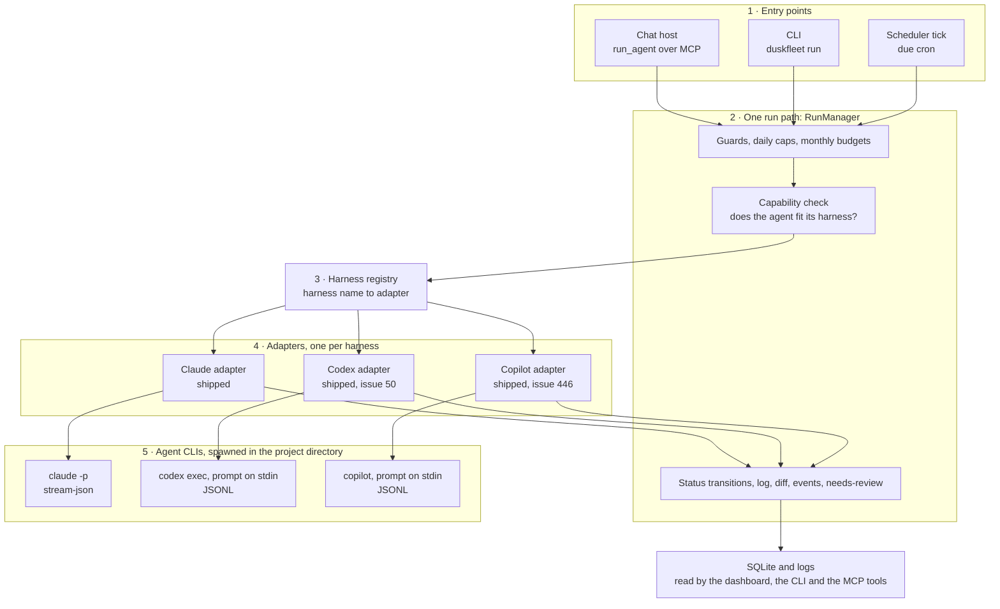
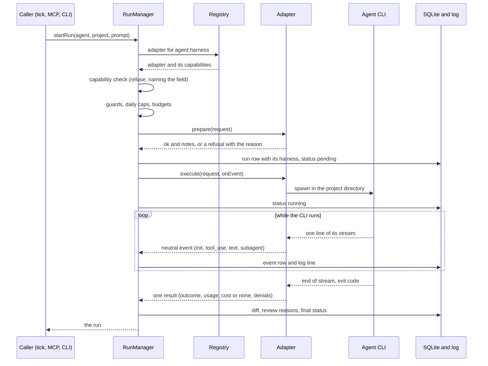
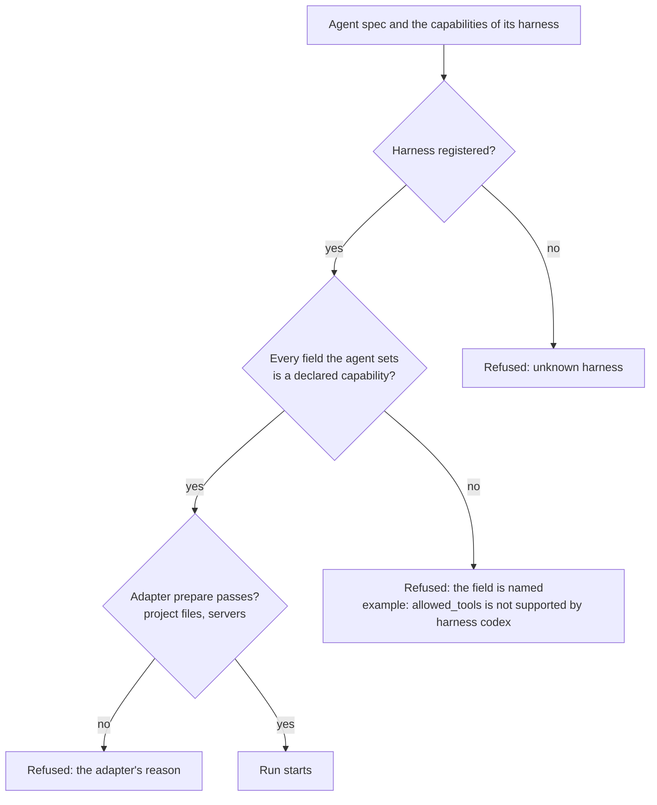
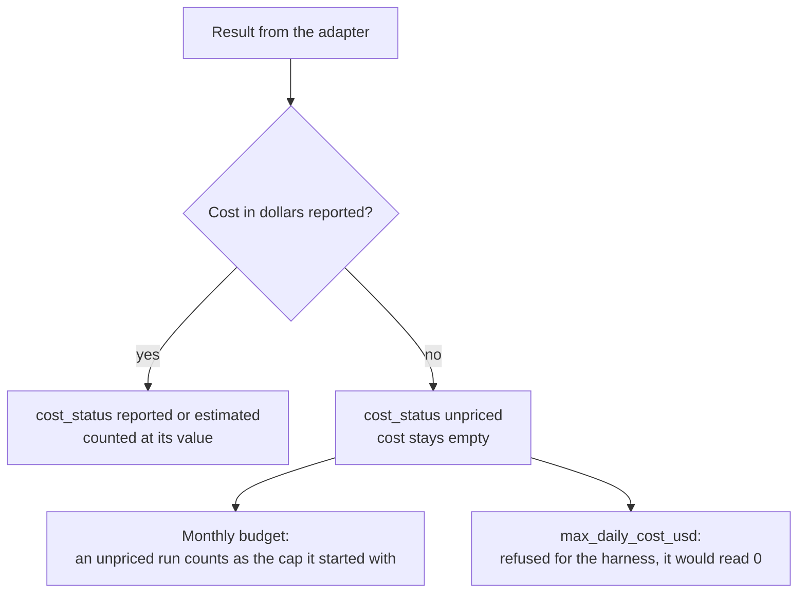
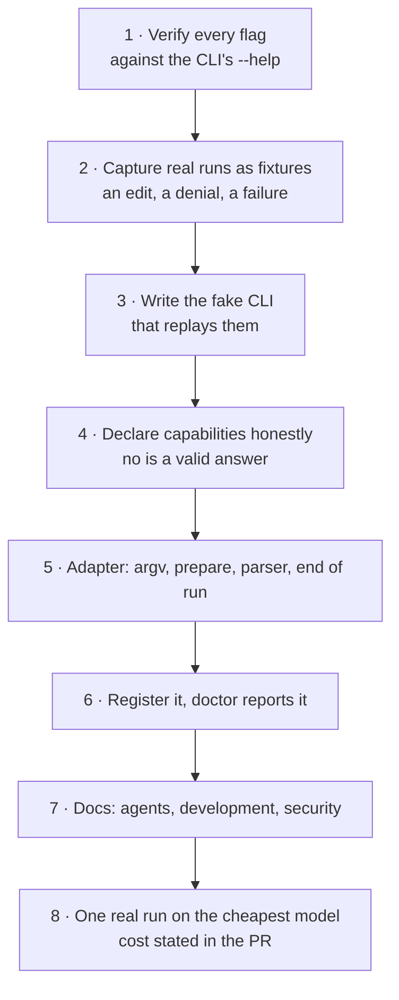

# Harness adapters: one run path, one adapter per agent CLI

A *harness* is an agent CLI that Duskfleet can spawn unattended. Claude Code (`claude`, the
default), GitHub Copilot CLI (`copilot`, [#446](https://github.com/duskfleet/duskfleet/issues/446))
and Codex CLI (`codex`, [#50](https://github.com/duskfleet/duskfleet/issues/50)) ship.

## The idea in one paragraph

Duskfleet has **one** run path. Everything that makes a run a Duskfleet run (schedule, guards,
budgets, status transitions, log, diff, timeline, needs-review) lives in that path and knows
nothing about any CLI. Each harness is an **adapter**: it turns a neutral request into that
CLI's command line, and that CLI's output stream into neutral events and one result. An agent
picks its harness with one frontmatter field, `harness:` (default `claude`; see
[Agents](agents.md#harness)).

One path per CLI was rejected: three copies of the guards, the budgets and the review rule would
drift, and every later fix would have to be made three times.

## The picture

Read it top to bottom. Boxes 1, 2, 3 and the store exist once. Only boxes 4 and 5 multiply.

## What an adapter is

An adapter implements the `Executor` interface of `packages/core/src/execution/types.ts`:
`harness` (the name agents select), `capabilities` (what it can honour), `binary`, `version()`,
`prepare()` (its own pre-flight checks, before the run row exists) and `execute()`. The adapters
are registered in a `HarnessRegistry` (`packages/core/src/execution/harness.ts`), built in
`packages/mcp/src/bootstrap.ts`; `RunManager` picks one per run from the agent's harness.

| An adapter owns | The run path keeps |
|---|---|
| Finding the binary and reading its version | Concurrency guards (agent, project, global cap) |
| Building the command line and the child's stdin | Daily caps and monthly budgets |
| Its pre-flight checks (Claude: `.claude/agents`, shadowed skills, required MCP servers) | The run row and every status transition |
| Parsing its output stream into neutral events | The JSONL log, its caps and its hash |
| Deciding how a run ends (result line, or inactivity timeout) | The diff of the run |
| Reporting usage, cost when the CLI gives one, denials, session id | The needs-review rule and its reasons |
| Its fixtures and its fake CLI for the tests | Scheduler outcomes, auto-pause, orphans |

The rule of thumb: if a line of code names a CLI flag, a folder such as `.claude/`, or an event
type of one stream, it belongs to an adapter. `RunManager` never contains
`if (harness === "codex")`.

## A run, step by step

Nothing before `prepare` and nothing after the result depends on which CLI ran.

## Capabilities: refuse, never approximate

Agent frontmatter was designed around Claude Code: `permission_mode`, `allowed_tools`,
`inherit_mcp`, `claude_agent`, `skills`, `max_budget_usd`. Another CLI has some of these, a
different version of some, and none of others. Each adapter therefore **declares** what it can
honour, and one function in core (`assertAgentFitsHarness`) compares an agent with its harness,
at create / update time and again at start.

Why refusal and not translation: these agents run with nobody watching. An allow-list that an
adapter silently dropped, or mapped onto something wider, is a permission the owner never
granted. A refused agent costs one error message; a quietly widened one costs trust. Claude's
tool rules are never mapped onto Copilot's `--allow-tool`: Copilot matches a shell command by its
first subcommand only (`shell(gh pr)` covers `gh pr merge`), so `Bash(gh pr create:*)` has no
equivalent. A Copilot agent writes Copilot's own rules instead (`toolRule` below).

The capability set, as the shipped adapters declare it:

| Capability | Meaning | claude | codex | copilot |
|---|---|---|---|---|
| `toolAllowList` | `allowed_tools` / `disallowed_tools` are enforced | yes | no: Codex has a sandbox mode, no tool rules | yes, Copilot's own rules (`--allow-tool` / `--deny-tool`) |
| `toolRule` | which entries the CLI takes as written | any | | `shell`, `shell(<cmd>)`, `write`, `write(<path>)`, `read`, `read(<path>)`, `url(<domain>)`, `memory`; anything else refused by name |
| `permissionModes` | `permission_mode` values it accepts | all (`bypassPermissions` still needs `claude.allow_bypass_permissions`) | `dontAsk` (`-s read-only`), `acceptEdits` (`-s workspace-write`); the network off in both | `dontAsk` (the rules only), `acceptEdits` (the rules plus `write`) |
| `resumeSession` | a session can be continued | yes | yes (`codex exec resume <thread_id>`, always with `-c sandbox_mode` from `permission_mode`) | yes (`--resume=<id>`) |
| `hardBudgetUsd` | the CLI stops at `max_budget_usd` | yes | no | no (its cap is in AI credits) |
| `reportsCostUsd` | the result carries a cost in dollars | yes | no (the stream has tokens only) | no (premium requests) |
| `subagents` | nested agents are reported as rows | yes | no | no (later issue) |
| `mcpInherit` | `inherit_mcp` gives the user's connectors | yes | no (`--ignore-user-config` drops the user's servers) | no (later issue) |
| `projectAgents` | `link` agents (`claude_agent`) | yes | no: nothing in the CLI loads an agent from a project folder | no |
| `addDirs` | `add_dirs` | yes | no (later issue: Codex's `--add-dir` makes a directory writable) | no: Copilot's `--add-dir` also trusts that directory's skills and agents |
| `skills`, `sandbox` | the fields of the same name | yes | no (Codex runs in its own sandbox, always) | no (later issues) |
| `effort` | `effort` | yes | yes (`-c model_reasoning_effort`) | yes (`--reasoning-effort`) |

A harness without `hardBudgetUsd` gets no `--max-budget-usd`-style cap and no wrap-up reserve,
and refuses a budget set for one run as well as the agent's own: a gate's `budget_usd`, a resume
budget (the agent's or the schedule's `resume_budget_usd`), with the field named, before
any row is written. A harness without `resumeSession` refuses `on_failure: resume_once`, and a
continued run of it starts a fresh session with a note. A harness without `reportsCostUsd` never
stores a cost, whatever its adapter returns: every run of it is `unpriced`.

## Cost when the CLI gives no dollars

No new machinery: the existing "unknown costs fail closed" rule covers it
([Agents](agents.md#unknown-costs-fail-closed)).

So a harness without dollar costs is safe by default, and expensive-looking: every run counts
as its full `max_budget_usd` (or `claude.default_max_budget_usd`). A unit other than dollars
(Copilot's premium requests) is a later issue, not part of the seam.

## What the three harnesses look like through the seam

| | claude (shipped) | codex (shipped, #50) | copilot (shipped, #446) |
|---|---|---|---|
| Unattended command | `claude -p --output-format stream-json` | `codex exec --json --ignore-user-config --ignore-rules ... -`, prompt on stdin | `copilot --output-format json`, prompt on stdin |
| Stream | stream-json lines | JSONL events (`thread.started`, `item.started` / `item.completed`, `turn.completed` / `turn.failed`) | JSONL events (`session.start`, `assistant.message`, `tool.execution_start` / `_complete`) |
| End of run | a `result` line | `turn.completed` or `turn.failed`; none = failed; 30 min without output = timed out (backstop) | a `result` line (`exitCode`), also after SIGTERM; none = failed |
| Permissions | allow-list per tool, `--permission-prompts none` | sandbox mode (`read-only` / `workspace-write`), network off | deny by default in a non-interactive run, `--allow-tool` / `--deny-tool` rules verbatim; `--allow-all*` never |
| System prompt | `--append-system-prompt` | `-c developer_instructions="<TOML string>"` | a per-run agent file, `--add-dir <tmp> --agent duskfleet-agent` |
| Session id | chosen by Duskfleet (`--session-id`) | chosen by Codex (`thread.started`'s `thread_id`) | chosen by Duskfleet (`--session-id`) |
| Cost | dollars, reported or estimated | unpriced; tokens from `turn.completed.usage` | unpriced (premium requests); tokens from `--usage-output-file` |
| Auth | the user's Claude login or API key | the user's Codex login (`codex login`, `~/.codex/auth.json`) | the user's GitHub login (`gh` / `copilot login`) |
| `link` agents | yes | no | no |

The Codex adapter (`core/src/execution/codex.ts`, parser `codex-jsonl.ts`) is registered the same
way: `CODEX_BIN`, then `codex.binary` in `duskfleet.yaml`, then `codex` on PATH (on Windows
`codex.exe`, then `codex.cmd`); `doctor` lists `codex not installed` otherwise. Its parser follows
real runs of codex-cli 0.167.1, kept as fixtures in `packages/mcp/test/fixtures/codex/` and
replayed by `fake-codex.js`. What it does and does not do:

- `--ignore-user-config` on every run: the user's `config.toml` (default model, `notify` program,
  trusted projects, MCP servers) never reaches a run. Authentication still comes from
  `CODEX_HOME` (default `~/.codex`), so no per-agent `CODEX_HOME` is created: the flag already
  gives the isolation that mattered, and session files stay in the user's store. An agent may
  still pass `CODEX_HOME` through `env_passthrough`.
- The project's `AGENTS.md` is Codex's own instruction file and is loaded, as `CLAUDE.md` is for
  Claude. The agent body goes in `developer_instructions`.
- `codex exec` checks that it runs inside a git repository (`--skip-git-repo-check` turns that
  off); Duskfleet never passes the flag, so keep a Codex agent's project a git repository (every
  fixture ran in one).
- A command the sandbox blocked is an ordinary failed command (`status: "failed"` and its own
  error text, exit 0): nothing in the stream names the sandbox, so it is not counted as a
  sandbox violation or a denial. The network stays off; an agent that needs it is a later issue.
- Sessions resume (`on_failure: resume_once`, a continued schedule, `run_agent { resume_run_id }`)
  with `codex exec resume ... <thread_id> -`. Resume has no `-s`; `-c sandbox_mode="<mode>"` decides
  the resumed turn's sandbox (verified by hand: a `workspace-write` session resumed as `read-only`
  cannot write), so it is passed on every resume, from the agent's `permission_mode` as it is now.
  `-m` is not passed on a resume (it was not part of the verified command), so the run records no
  model. A thread Codex no longer has (`no rollout found` on stderr) makes a continued run start
  fresh with a note, as for the other harnesses; a `resume_once` retry of it fails.
  `resume_budget_usd` stays refused (no dollar budget).
- `effort` is passed as written; a value the model does not know fails the run with Codex's own
  error.

The Copilot adapter (`core/src/execution/copilot.ts`, parser `copilot-jsonl.ts`) is registered
only when its binary resolves: `COPILOT_BIN`, then `copilot.binary` in `duskfleet.yaml`, then
`copilot` on PATH (on Windows `copilot.exe`, then npm's `copilot.cmd` shim, which is spawned
through `cmd.exe` with every argument escaped, since Node refuses a batch file without a shell). Without one, `doctor` lists `copilot not installed` and an agent on it is
refused at run start. Its parser was written against real runs of Copilot CLI 1.0.112, kept as
fixtures in `packages/mcp/test/fixtures/copilot/` (their README lists what each run shows); the
tests replay them through `fake-copilot.js`.

Its `prepare` lists the configured MCP servers (`copilot mcp list --json`, in the project folder)
and disables each with `--disable-mcp-server`; a listing that fails refuses the run before its row
exists. Two things the Copilot adapter detects and refuses at run time rather than guessing: an
MCP server that loaded anyway (any `session.mcp_servers_loaded` entry not `disabled` ends the run
as failed, until `mcpInherit` exists), and an unknown session on `--resume` (stderr `No session,
task, or name matched`, `sessionNotFound`). A rate limit has no fixture yet, so it is not
classified as `provider_quota`.

## What is *not* a harness

Pointing Claude Code at another model (an Anthropic-compatible endpoint, a gateway) keeps the
harness `claude`: same CLI, same stream, same adapter, only `ANTHROPIC_BASE_URL` and the model
name change. GitHub's cloud coding agent (an issue assigned to Copilot) is not a harness either:
the run happens on GitHub, Duskfleet records nothing.

## Adding a harness: the checklist

Fixtures come before code because the stream of a CLI is the contract, and the docs of all
three describe it less precisely than a captured run does. Tests never launch a real CLI. The
same list, with file names: [Development](development.md#extending).

## Where things are

| | |
|---|---|
| Registry, capabilities, the refusal | `packages/core/src/execution/harness.ts` (`HarnessRegistry`, `HarnessCapabilities`, `assertAgentFitsHarness`) |
| The Claude adapter | `packages/core/src/execution/claude-code.ts` (`ClaudeCodeExecutor`, its `prepare`) |
| Which adapters a process has | `packages/mcp/src/bootstrap.ts`; `doctor` prints one line per harness |
| What a run records | `runs.harness` (migration 31, older rows `claude`); the harness's session id and version stay in `claude_session_id` / `claude_code_version` |
| Shared defaults | still `claude.default_timeout_minutes`, `claude.default_max_budget_usd`, `claude.max_log_bytes`, `claude.max_event_bytes`; a neutral home comes with the second harness |
