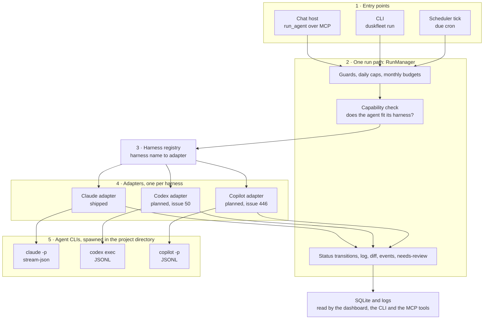
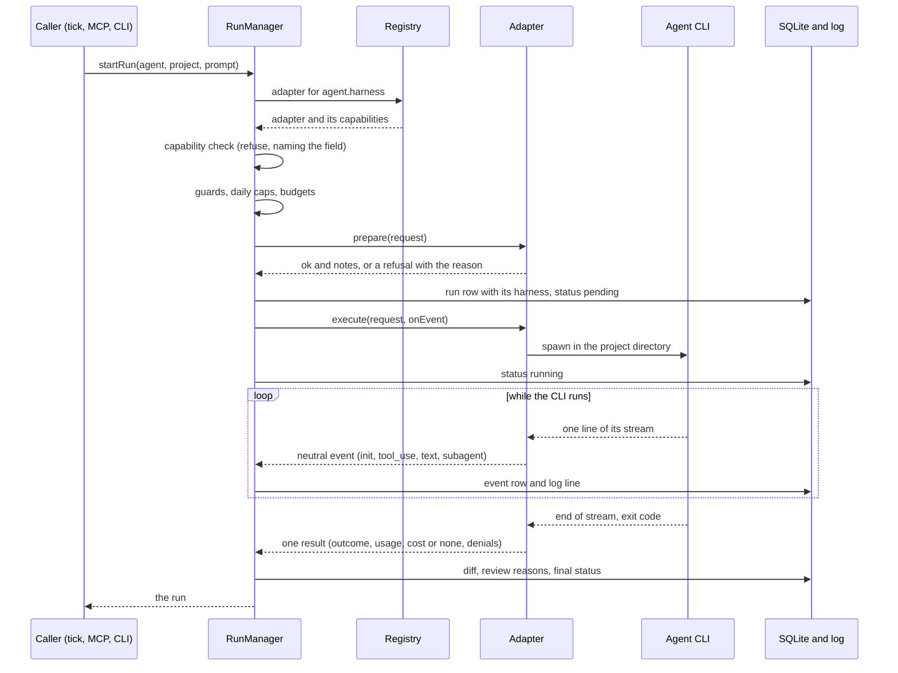
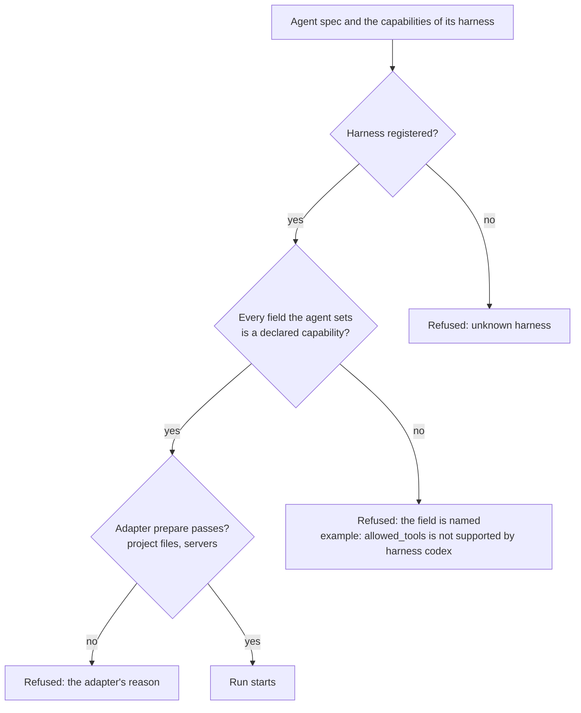
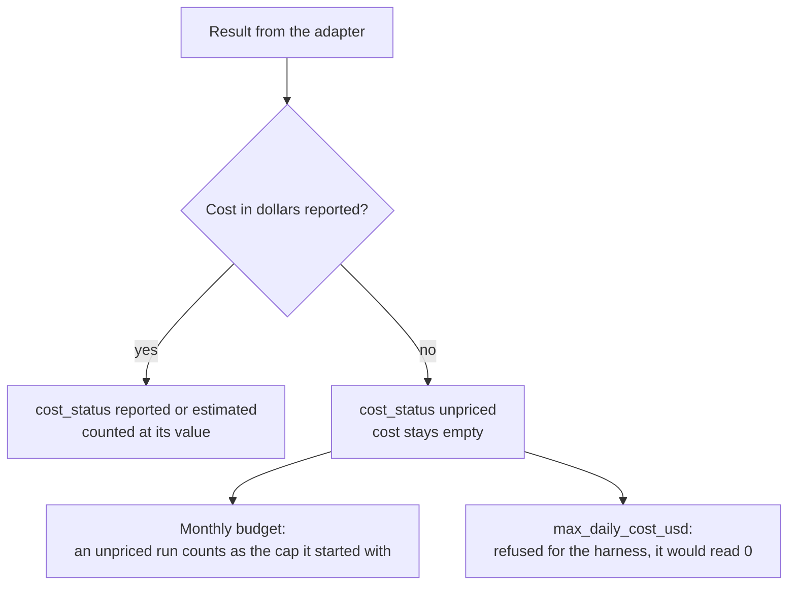
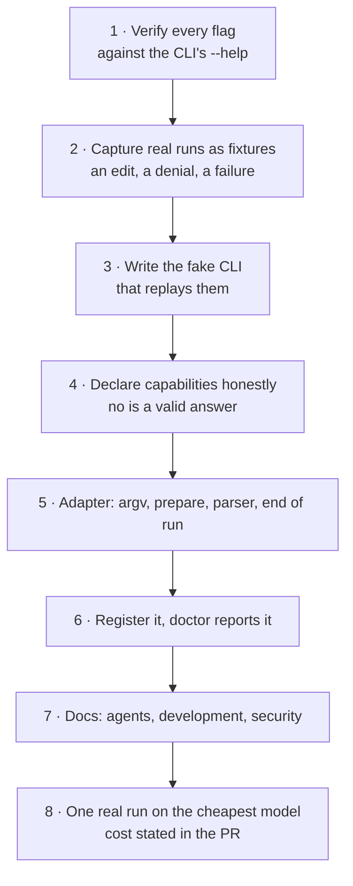

# Harness adapters: one run path, one adapter per agent CLI

A *harness* is an agent CLI that Duskfleet can spawn unattended. Claude Code (`claude`) is the one
that ships; Codex CLI ([#50](https://github.com/duskfleet/duskfleet/issues/50)) and GitHub Copilot
CLI ([#446](https://github.com/duskfleet/duskfleet/issues/446)) are planned.

## The idea in one paragraph

Duskfleet has **one** run path. Everything that makes a run a Duskfleet run (schedule, guards,
budgets, status transitions, log, diff, timeline, needs-review) lives in that path and knows
nothing about any CLI. Each harness is an **adapter**: it turns a neutral request into that
CLI's command line, and that CLI's output stream into neutral events and one result. An agent
picks its harness with one frontmatter field, `harness:` (default `claude`; see
[Agents](agents.md#harness)).

One path per CLI was rejected: three copies of the guards, the budgets and the review rule would
drift, and every later fix would have to be made three times.

## The picture

Read it top to bottom. Boxes 1, 2, 3 and the store exist once. Only boxes 4 and 5 multiply.

## What an adapter is

An adapter implements the `Executor` interface of `packages/core/src/execution/types.ts`:
`harness` (the name agents select), `capabilities` (what it can honour), `binary`, `version()`,
`prepare()` (its own pre-flight checks, before the run row exists) and `execute()`. The adapters
are registered in a `HarnessRegistry` (`packages/core/src/execution/harness.ts`), built in
`packages/mcp/src/bootstrap.ts`; `RunManager` picks one per run from the agent's harness.

| An adapter owns | The run path keeps |
|---|---|
| Finding the binary and reading its version | Concurrency guards (agent, project, global cap) |
| Building the command line and the child's stdin | Daily caps and monthly budgets |
| Its pre-flight checks (Claude: `.claude/agents`, shadowed skills, required MCP servers) | The run row and every status transition |
| Parsing its output stream into neutral events | The JSONL log, its caps and its hash |
| Deciding how a run ends (result line, or inactivity timeout) | The diff of the run |
| Reporting usage, cost when the CLI gives one, denials, session id | The needs-review rule and its reasons |
| Its fixtures and its fake CLI for the tests | Scheduler outcomes, auto-pause, orphans |

The rule of thumb: if a line of code names a CLI flag, a folder such as `.claude/`, or an event
type of one stream, it belongs to an adapter. `RunManager` never contains
`if (harness === "codex")`.

## A run, step by step

Nothing before `prepare` and nothing after the result depends on which CLI ran.

## Capabilities: refuse, never approximate

Agent frontmatter was designed around Claude Code: `permission_mode`, `allowed_tools`,
`inherit_mcp`, `claude_agent`, `skills`, `max_budget_usd`. Another CLI has some of these, a
different version of some, and none of others. Each adapter therefore **declares** what it can
honour, and one function in core (`assertAgentFitsHarness`) compares an agent with its harness,
at create / update time and again at start.

Why refusal and not translation: these agents run with nobody watching. An allow-list that an
adapter silently dropped, or mapped onto something wider, is a permission the owner never
granted. A refused agent costs one error message; a quietly widened one costs trust. An adapter
may *later* add a real mapping (Claude's tool rules onto Copilot's `--allow-tool`), and then it
declares the capability; until it does, the field is refused.

The capability set. The `claude` column is what the shipped adapter declares; the Codex and
Copilot columns are expectations to verify against each CLI's `--help` and real runs, not facts.

| Capability | Meaning | claude | codex (planned) | copilot (planned) |
|---|---|---|---|---|
| `toolAllowList` | `allowed_tools` / `disallowed_tools` are enforced | yes | no, a sandbox mode instead | to verify (`--allow-tool`) |
| `permissionModes` | `permission_mode` values it accepts | all (`bypassPermissions` still needs `claude.allow_bypass_permissions`) | to map onto sandbox modes | to verify |
| `resumeSession` | a session can be continued | yes | to verify | to verify |
| `hardBudgetUsd` | the CLI stops at `max_budget_usd` | yes | no | no |
| `reportsCostUsd` | the result carries a cost in dollars | yes | no on a subscription | no (premium requests) |
| `subagents` | nested agents are reported as rows | yes | no | to verify |
| `mcpInherit` | `inherit_mcp` gives the user's connectors | yes | to verify | to verify |
| `projectAgents` | `link` agents (`claude_agent`) | yes | no | no |
| `addDirs`, `skills`, `effort`, `sandbox` | the fields of the same name | yes | to verify | to verify |

A harness without `hardBudgetUsd` gets no `--max-budget-usd`-style cap and no wrap-up reserve,
and refuses a budget set for one run as well as the agent's own: a gate's `budget_usd`, a resume
budget (the agent's or the schedule's `resume_budget_usd`), with the field named, before
any row is written. A harness without `resumeSession` refuses `on_failure: resume_once`, and a
continued run of it starts a fresh session with a note. A harness without `reportsCostUsd` never
stores a cost, whatever its adapter returns: every run of it is `unpriced`.

## Cost when the CLI gives no dollars

No new machinery: the existing "unknown costs fail closed" rule covers it
([Agents](agents.md#unknown-costs-fail-closed)).

So a harness without dollar costs is safe by default, and expensive-looking: every run counts
as its full `max_budget_usd` (or `claude.default_max_budget_usd`). A unit other than dollars
(Copilot's premium requests) is a later issue, not part of the seam.

## What the three harnesses look like through the seam

| | claude (shipped) | codex (#50, planned) | copilot (#446, planned) |
|---|---|---|---|
| Unattended command | `claude -p --output-format stream-json` | `codex exec --json`, prompt on stdin | `copilot -p`, `--output-format json` |
| Stream | stream-json lines | JSONL events (`thread.started`, `item.completed`, `turn.completed`) | JSONL, schema to capture from real runs |
| End of run | a `result` line | no result line: inactivity timeout | to verify |
| Permissions | allow-list per tool, `--permission-prompts none` | sandbox mode (`workspace-write`, network off) | `--allow-tool` rules, or `--allow-all-tools` (opt-in only) |
| Cost | dollars, reported or estimated | unpriced on a subscription | unpriced (premium requests) |
| Auth | the user's Claude login or API key | per-agent `CODEX_HOME`, `auth.json` linked | the user's GitHub login |
| `link` agents | yes | no | no |

## What is *not* a harness

Pointing Claude Code at another model (an Anthropic-compatible endpoint, a gateway) keeps the
harness `claude`: same CLI, same stream, same adapter, only `ANTHROPIC_BASE_URL` and the model
name change. GitHub's cloud coding agent (an issue assigned to Copilot) is not a harness either:
the run happens on GitHub, Duskfleet records nothing.

## Adding a harness: the checklist

Fixtures come before code because the stream of a CLI is the contract, and the docs of all
three describe it less precisely than a captured run does. Tests never launch a real CLI. The
same list, with file names: [Development](development.md#extending).

## Where things are

| | |
|---|---|
| Registry, capabilities, the refusal | `packages/core/src/execution/harness.ts` (`HarnessRegistry`, `HarnessCapabilities`, `assertAgentFitsHarness`) |
| The Claude adapter | `packages/core/src/execution/claude-code.ts` (`ClaudeCodeExecutor`, its `prepare`) |
| Which adapters a process has | `packages/mcp/src/bootstrap.ts`; `doctor` prints one line per harness |
| What a run records | `runs.harness` (migration 31, older rows `claude`); the harness's session id and version stay in `claude_session_id` / `claude_code_version` |
| Shared defaults | still `claude.default_timeout_minutes`, `claude.default_max_budget_usd`, `claude.max_log_bytes`, `claude.max_event_bytes`; a neutral home comes with the second harness |
