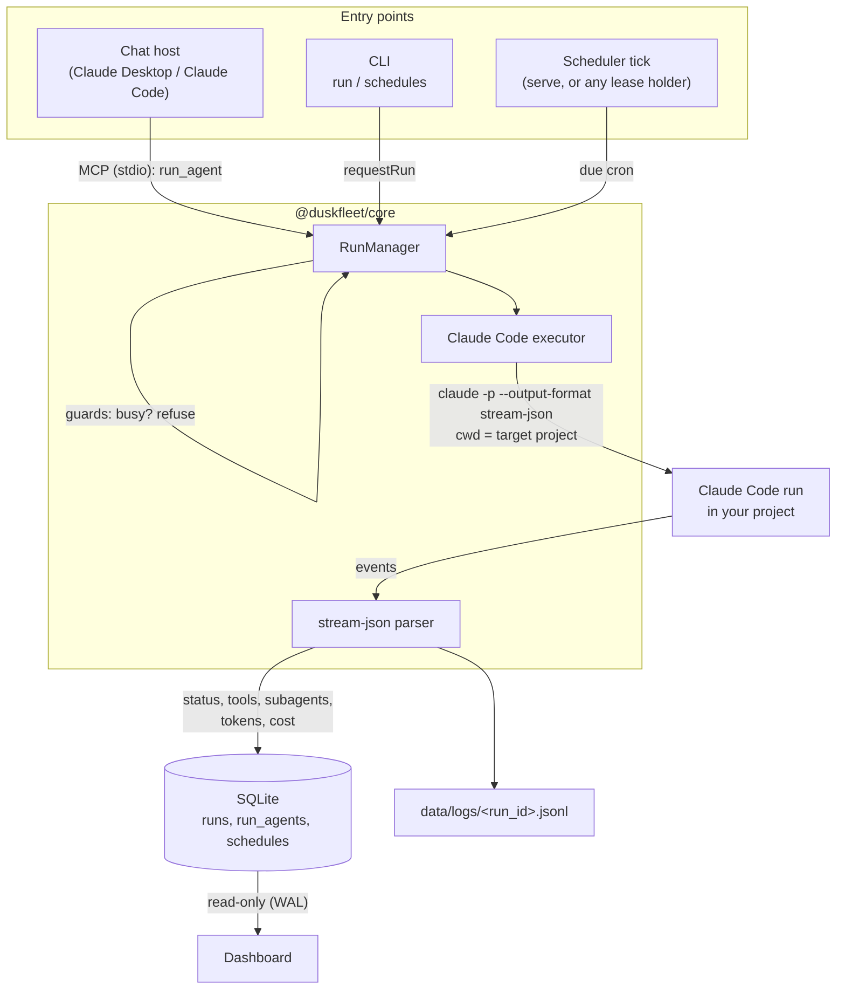
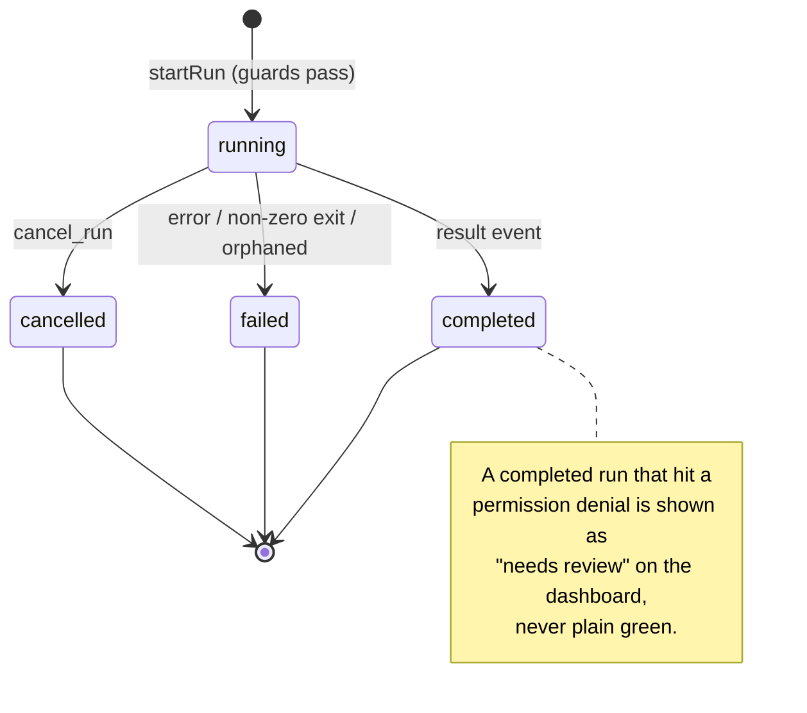

# How it works

Duskfleet is a local orchestrator for unattended Claude Code runs. Three deliverables — the
MCP server, the CLI and the dashboard — share one `config/` directory and one SQLite
database. This page follows a run end to end; the other pages go deeper on each part.



## From request to child process

Every run starts as a call to `RunManager.startRun`, whether it comes from a chat (the MCP
tool `run_agent`), from `duskfleet run` on the CLI, or from a cron
[schedule](schedules.md) firing. The run manager applies the concurrency guards first — one
run per project directory and one per agent by default, see
[Configuration](configuration.md) — and **refuses** when something is busy; nothing is ever
queued. A schedule treats that refusal as "skip this tick" (`skipped_busy`).

The executor then spawns the Claude Code CLI:

```bash
claude -p --output-format stream-json ...   # cwd = the target project
```

The [agent](agents.md) decides the rest of the command line: its permission mode, its tool
allow-list, its model and budget, and — for a *link* agent — the `--agent <name>` of a
persona the project itself defines in `.claude/agents/`. Runs are unattended: there are no
permission prompts, so anything not allow-listed is denied and recorded. Children get
`--strict-mcp-config` and never see the caller's MCP servers (Duskfleet cannot recurse into
itself) unless the agent or project opts into `inherit_mcp`.

## What gets recorded

The child's stdout is a stream of JSON events. The parser folds them into the database as
they arrive and keeps the raw stream in `data/logs/<run_id>.jsonl`:

- the run row: status, timings, model, tokens, cost, tool calls, permission denials,
  termination reason;
- one `run_agents` row per subagent the run delegated to (type, brief, report, duration);
- the final message and the resume command for the Claude session;
- when the project is a git checkout, what the run changed: HEAD is recorded before the
  spawn, and when the run ends a `diff` event lists the changed files with lines added and
  deleted (commits made during the run, uncommitted edits and untracked files, scoped to the
  project directory; at most 200 files listed) and the patch goes to
  `data/logs/<run_id>.diff` (cut at 1 MB). `get_run` and `run-info` return it as `diff`, the
  run page shows it under "Changes". A project that is not a git checkout gets no diff.
  Edits that were already uncommitted before the run are part of the diff too. Lines of
  untracked files are counted for the first 1000 files / 64 MB only; past that a file is listed
  as "not counted" and the totals are marked partial (`totalsPartial`). An untracked symlink
  counts as one line (its target is never read); a nested repository or anything else that is
  not a regular file is listed as "not counted". The whole capture has a 30 s budget: work
  past it is skipped and marked the same way. `patchTruncated` means the patch is incomplete
  (cut at 1 MB, or a git read failed or ran out of time). Diff and textconv drivers of the
  checkout never run.

`RunManager` is the only writer of a run's status, and every change goes through a checked
transition. Each run records its owner process; orphan recovery closes a `running` row as
failed only when that owner is gone, so several Duskfleet processes can share the database
safely.

## Run lifecycle



The [dashboard](dashboard.md) reads the same database (WAL mode) and never mutates runs: it
is the observation side of the loop. The [CLI](cli.md) covers the same ground from the
terminal, and `install-service` keeps the scheduler ticking when no chat host is open.
