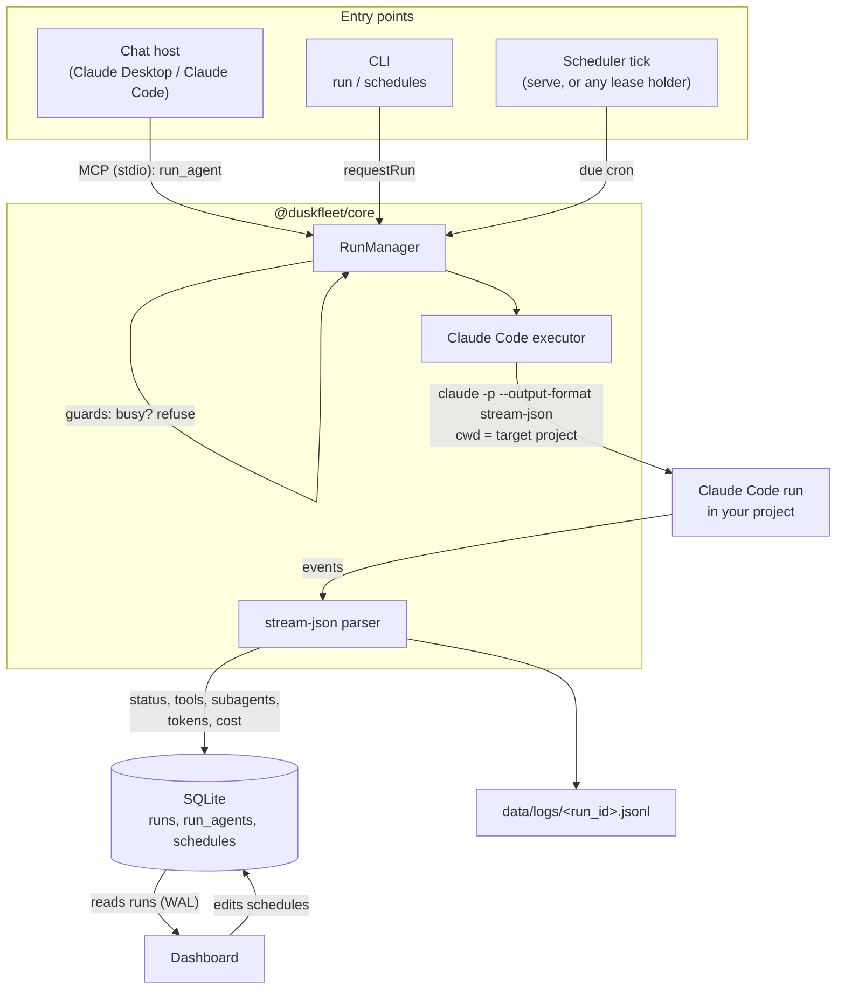
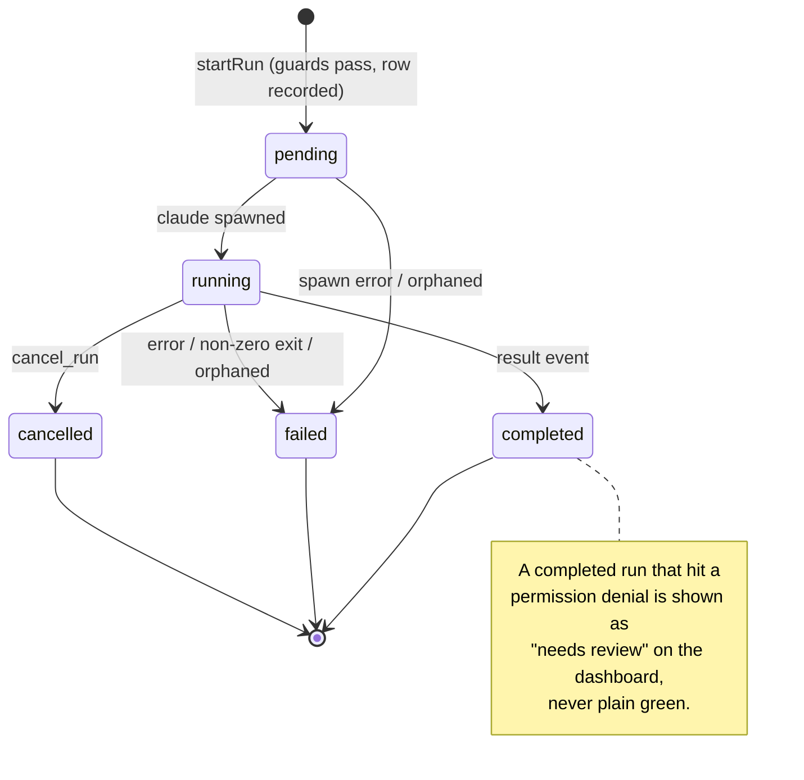

# How it works

Duskfleet is a local orchestrator for unattended Claude Code runs. Three deliverables — the
MCP server, the CLI and the dashboard — share one `config/` directory and one SQLite
database. This page follows a run end to end; the other pages go deeper on each part.



## From request to child process

Every run starts as a call to `RunManager.startRun`, whether it comes from a chat (the MCP
tool `run_agent`), from `duskfleet run` on the CLI, or from a cron
[schedule](schedules.md) firing. The run manager applies the concurrency guards first — one
run per project directory and one per agent by default, see
[Configuration](configuration.md) — and **refuses** when something is busy; nothing is ever
queued. A schedule keeps that tick as its one pending fire, retried every tick until it starts
or the next cron occurrence comes (`deferred`, then `skipped_busy` if it never started; see
[busy ticks](schedules.md#busy-ticks-one-deferred-fire)).

The executor then spawns the Claude Code CLI:

```bash
claude -p --output-format stream-json ...   # cwd = the target project
```

The [agent](agents.md) decides the rest of the command line: its permission mode, its tool
allow-list, its model and budget, and — for a *link* agent — the `--agent <name>` of a
persona the project itself defines in `.claude/agents/`. Runs are unattended: there are no
permission prompts, so anything not allow-listed is denied and recorded. Children get
`--strict-mcp-config` and never see the caller's MCP servers (Duskfleet cannot recurse into
itself) unless the agent or project opts into `inherit_mcp`.

## What gets recorded

The child's stdout is a stream of JSON events. The parser folds them into the database as
they arrive and keeps the raw stream in `data/logs/<run_id>.jsonl`:

- the run row: status, timings, model, tokens, cost, tool calls, permission denials,
  termination reason;
- one `run_agents` row per subagent the run delegated to (type, brief, report, duration);
- the final message and the resume command for the Claude session;
- when the project is a git checkout, what the run changed: the checkout is snapshotted before
  the spawn (HEAD, the files already changed or untracked with a fingerprint of each, a
  `git stash create` commit of the tracked edits, which adds no stash entry and touches neither
  the files nor the index, and the repository's worktrees and branches), and when the run ends a
  `diff` event lists the changed files with lines added and deleted (commits made during the
  run, uncommitted edits and untracked files, scoped to the project directory; at most 200
  files listed) and the patch goes to `data/logs/<run_id>.diff` (cut at 1 MB). `get_run` and
  `run-info` return it as `diff`, the run page shows it under "Changes". A project that is not
  a git checkout gets no diff.
  Changes that were already there before the run are left out when the run leaves them as they
  were: `preexisting` counts them, and a run that touches nothing on a dirty checkout shows an
  empty diff. A file already changed before and changed again by the run stays listed, marked
  `preexisting` ("also changed before the run"); for a tracked file the lines and the patch are
  the run's own delta, for a file that was untracked they cover the whole file.
  Work done in a git worktree is listed under `worktrees`, one entry per worktree created during
  the run or whose HEAD moved: its committed and uncommitted changes against its base (HEAD at
  the start for a worktree that existed, else the tip of the branch it was created from, local
  or remote-tracking) and its commits (`git log base..head`, 50 at most). A worktree removed
  before the run ended leaves its branch: a branch that appeared or moved during the run with no
  worktree on it is listed with `removed: true` and its `base...branch` diff. Their patches are
  appended to the same `.diff` file after a `# worktree <path>` or `# branch <name>` line. The
  checkout's own worktree and branch are never in that list; another process working in a
  worktree of the same repository at the same time would show up there too. Lines of
  untracked files are counted for the first 1000 files / 64 MB only; past that a file is listed
  as "not counted" and the totals are marked partial (`totalsPartial`). An untracked symlink
  counts as one line (its target is never read); a nested repository or anything else that is
  not a regular file is listed as "not counted". The whole capture has a 30 s budget: work
  past it is skipped and marked the same way. `patchTruncated` means the patch is incomplete
  (cut at 1 MB, or a git read failed or ran out of time). Diff and textconv drivers of the
  checkout never run.
- the log's size and SHA-256 (`logBytes`, `logSha256`; `log_bytes`, `log_sha256` in the
  database), taken from the file as written when the run ends, and `logTruncated`. `get_run`
  and `run-info` return them; the run page shows them under "Technical details".

Both stores are bounded. One `run_events` payload is at most `claude.max_event_bytes`
(default 64 KiB): over it the stored JSON keeps its envelope (type, ids, tool name) and the
longest strings are cut, each ending with `…[truncated N bytes]` (when that is not enough, the
largest nested arrays and objects become `{ truncated, bytes }` stubs), and the payload gets
`truncated: true`; the raw JSONL line is always written in full. The `diff` event is exempt:
it is already bounded (at most 200 files listed, the patch in its own file). The raw log is at most
`claude.max_log_bytes` (default 50 MiB): the line that would cross it is replaced by one final
`{"type":"duskfleet_log_truncated","bytes_dropped_from_here":true}` line and nothing more is
written to the file. The run keeps going, its events keep reaching the database (the source of
truth), and the run is stored with `logTruncated: true`.

`RunManager` is the only writer of a run's status, and every change goes through a checked
transition. Each run records its owner process; orphan recovery closes a `running` row, or a
`pending` one whose process died between recording the run and spawning claude, as failed only
when that owner is gone, so several Duskfleet processes can share the database safely. Their
writes wait up to 5 s for each other (SQLite busy timeout) rather than failing with "database is
locked". A run that spawned but could not be marked `running` (that write failed anyway) is
stopped at once and ends `failed` with the reason: its process listens for the end before that
write, so a child nobody listens to can never leave its row open while its owner is alive.

## Run lifecycle



The [dashboard](dashboard.md) reads the same database (WAL mode) and never mutates runs: it
is the observation side of the loop. The [CLI](cli.md) covers the same ground from the
terminal, and `install-service` keeps the scheduler ticking when no chat host is open.
